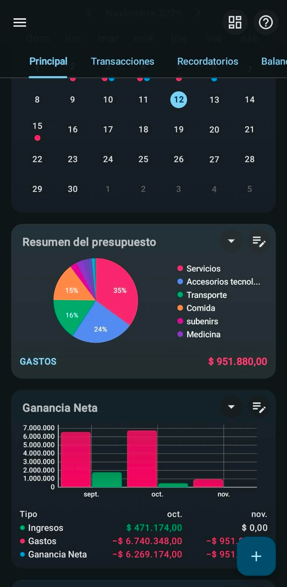
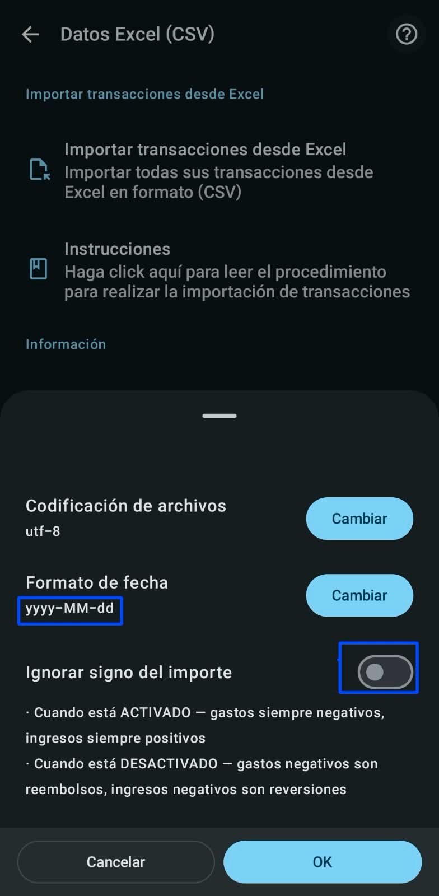

# Money Manager to Bluecoins ETL Pipeline

Un pipeline ETL (Extract, Transform, Load) desarrollado en Python para automatizar la extracción, limpieza y migración de datos financieros desde la base de datos SQLite de **Money Manager** hacia un formato CSV estructurado y compatible con la importación directa en **Bluecoins**.

---

## 🛠️ Stack Tecnológico
- **Lenguaje:** Python 3.x
- **Librerías Principales:** `pandas`, `sqlite3`, `os`
- **Patrón de Arquitectura:** Modular (Separación estricta de responsabilidades en capas ETL)
- **Buenas Prácticas:** Configuración parametrizada mediante variables de entorno.

---

## 📂 Arquitectura del Proyecto

El proyecto está diseñado bajo un enfoque modular para facilitar la mantenibilidad, pruebas y escalabilidad:

```text
money-manager-to-bluecoins-etl/
├── main.py                  # Orquestador principal y gestión de entorno
├── extract.py               # Capa Extract: Conexión segura en solo lectura a SQLite
├── transform.py             # Capa Transform: Limpieza, fechas, divisas y tipos de transacción
├── load.py                  # Capa Load: Generación del archivo CSV final para Bluecoins
├── money_android.sqlite     # Base de datos de origen (Money Manager)
└── README.md                # Documentación del proyecto
```

---

## 🔄 Flujo de Trabajo (ETL)

1. **Extract (`extract.py`):**
   - Conexión lógica en solo lectura a la base de datos SQLite.
   - Extracción de transacciones utilizando consultas parametrizadas para evitar inyecciones SQL.
   - Resolución de cuentas, categorías, etiquetas y mapeos estructurales (como tarjetas de débito y patrones de divisas).

2. **Transform (`transform.py`):**
   - Conversión de marcas de tiempo (`ZDATE`) desde milisegundos Unix a fechas legibles con soporte de huso horario parametrizado (`America/Bogota` por defecto).
   - Normalización de códigos de divisas (ej. `COP_COP` a `COP`).
   - Limpieza y saneamiento de campos de texto (`NOTE`, `D_DESCRIPTION`).
   - Limpieza de montos (`AMOUNT`), manejo de signos según el tipo de transacción (`DO_TYPE`) y resolución de transferencias.**************************
   - Mapeo y normalización de tipos de transacción (`DO_TYPE`): Clasificación y estandarización de registros en categorías operativas (Ingresos, Gastos y Transferencias).
   - Aplicación de tasas de cambio: Conversión de montos multidivisa utilizando tasas de cambio de referencia para estandarizar la moneda base del reporte. 

3. **Load (`load.py`):**
   - Validación final de datos: Verificación de esquemas, control de nulos críticos y consistencia del DataFrame transformado antes de la persistencia.
   - Exportación estructurada: Generación del archivo `final bluecoins_ready_import.csv` con los tipos de datos correctos, codificación estándar y los delimitadores exactos requeridos para una importación limpia en Bluecoins.

4. **Load (`main.py`):**
   - Control secuencial del flujo: Coordinación ordenada de las fases del pipeline (Extract -> Transform -> Load).
   - Gestión de ejecución y entorno: Lectura centralizada de variables de configuración y manejo del flujo de ejecución del script.
 


---

## ⚙️ Configuración (Variables de Entorno)

El pipeline soporta la parametrización de sus rutas, rangos de fechas y zona horaria a través de variables de entorno, permitiendo su ejecución flexible sin modificar el código fuente:

| Variable | Descripción | Valor por Defecto |
| :--- | :--- | :--- |
| `ETL_DB_PATH` | Ruta de la base de datos SQLite de origen | `money_android.sqlite` |
| `ETL_OUTPUT_CSV` | Ruta del archivo CSV de salida | `bluecoins_ready_import.csv` |
| `ETL_START_DATE` | Fecha de inicio para la extracción (`YYYY-MM-DD`) | `2017-01-01` |
| `ETL_END_DATE` | Fecha de fin para la extracción (`YYYY-MM-DD`) | `2026-12-31` |
| `ETL_TIMEZONE` | Zona horaria objetivo para las fechas | `America/Bogota` |

---

## 🚀 Guía de Instalación y Ejecución

### 1. Clonar el repositorio
```bash
git clone https://github.com/Josecampu/money-manager-to-bluecoins-etl
cd money-manager-to-bluecoins-etl
```

### 2. Instalar dependencias
Asegúrate de tener Python instalado y ejecuta:
```bash
pip install pandas
```

### 3. Colocar la base de datos
Asegúrate de ubicar tu archivo de respaldo de Money Manager (`money_android.sqlite`) en la raíz del proyecto.

### 4. Ejecutar el pipeline
Puedes ejecutar el script directamente:
```bash
python main.py
```

O bien, definir variables de entorno en tu terminal antes de correrlo (opcional):
```bash
export ETL_START_DATE="2024-01-01"
export ETL_END_DATE="2026-11-12"
export TARGET_TIMEZONE="America/Bogota"
python main.py
```

## ⚙️ Configuración de Importación en Bluecoins

Una vez que el pipeline genera el archivo CSV final, la importación en la aplicación móvil o de escritorio de Bluecoins requiere verificar el mapeo de columnas para que las transferencias y los signos se procesen correctamente:

1. Abre Bluecoins y ve a **Ajuste** > **Gestión de datos** > **Importar Excel(.csv)** > **Importar trnasaions de Excel**.
2. Selecciona el archivo generado por el ETL (`transacciones_bluecoins.csv`).
3. Asegurate de elegir las siguientes configuraciones.
> **Vista previa de la configuración en la App:**



## Resultados


